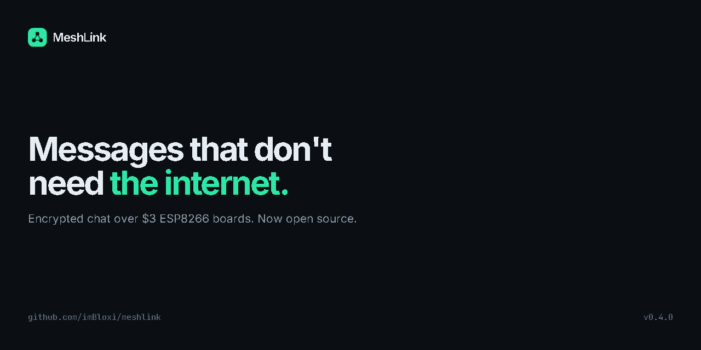
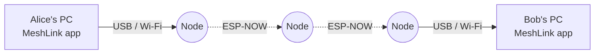

<p align="center">
  
</p>

<p align="center">
  <a href="https://github.com/imBloxi/meshlink/actions/workflows/ci.yml"></a>
  <a href="https://github.com/imBloxi/meshlink/releases"></a>
  <a href="LICENSE"></a>
  
  <a href="docs/break-meshlink.md"></a>
</p>

<p align="center">
  <b>Private, off-grid messaging over a mesh of $3 ESP8266 boards.</b><br>
  No internet, no router, no cloud, no sign-up. Private by default.
</p>

<p align="center">
  <a href="#quick-start">Quick start</a> ·
  <a href="#how-it-works">How it works</a> ·
  <a href="#privacy-by-default">Privacy</a> ·
  <a href="https://imbloxi.github.io/meshlink/">Website</a> ·
  <a href="PROTOCOL.md">Protocol</a> ·
  <a href="SECURITY.md">Security</a> ·
  <a href="docs/break-meshlink.md">Break it</a>
</p>

---

## Why MeshLink

- **Works with no network at all.** Nodes talk to each other directly over ESP-NOW radio. A node plugged into nothing but power is a repeater.
- **End-to-end encrypted.** The desktop app encrypts every message before it leaves your PC. Nodes only ever relay ciphertext.
- **Cheap hardware.** A D1 mini or NodeMCU board costs about $3. The app flashes it for you.
- **Direct messages and rooms.** Private rooms with invites, moderators and key rotation, plus public rooms anyone on your network can join.
- **Your own network.** Give your nodes a network key. Outsiders can't send into it, and the network owner can ban nodes and guests with signed policies.
- **Open and auditable.** GPL-3.0, a documented protocol, and a public [challenge](docs/break-meshlink.md) to break it.

> **Think you can break it?** We published a full radio capture of a private conversation. Decrypt it and win: [Break MeshLink](docs/break-meshlink.md).

## Quick start

### 1. Get the app
Download the Windows installer from [Releases](https://github.com/imBloxi/meshlink/releases) and check it against `SHA256SUMS.txt`.

The installer is not code-signed yet, so SmartScreen may warn you. Choose **More info**, then **Run anyway**.

### 2. Flash two boards
Plug a board into USB and choose **Connect → Flash a new board**. The app checks the bundled firmware's SHA-256 and writes it with Espressif's esptool-js. Repeat for the second board. No per-board setup is needed.

> **Updating from 0.4.1 or older?** 0.4.2 changes the protocol (v3). Update every app **and reflash every node** together. Fingerprints and safety numbers change, so verify your contacts again. See the [changelog](CHANGELOG.md).

### 3. Chat
Connect each board to a PC running MeshLink. The apps find each other and appear in **Contacts**.

**Before you trust a contact, compare the safety number in person** (Contact → Verify). Anyone in radio range can pick any name.

**No boards yet?** Choose **Connect → Simulator** in two app windows.

## How it works



| Layer | What it does | Crypto |
|-------|--------------|--------|
| App to app | Encrypts and signs every message | NaCl box / secretbox (X25519, XSalsa20-Poly1305), Ed25519 |
| Node to node | Floods frames over ESP-NOW, drops duplicates, rate-limits | Keyed BLAKE2s tag with the network key |
| App to node | USB serial (admin) or the node's Wi-Fi hotspot (guest) | Guest login with a per-network key |

The full wire format is in [PROTOCOL.md](PROTOCOL.md).

## Privacy by default

MeshLink makes no network calls unless you ask, and it keeps as little as possible readable, on the air and on disk.

| | Default |
|---|---|
| Message content | End-to-end encrypted. Nodes never see plaintext. |
| Who a DM is for | Hidden. There is no recipient field: devices try their contacts' keys. |
| Message length | Hidden. Every DM and room frame on the air is exactly 225 bytes. |
| History on your PC | Encrypted, including contacts, senders and settings. The database file shows no names or fingerprints. |
| Keys on your PC | Protected by Windows DPAPI. Encrypted backups use Argon2id. |
| Notifications | Windows only shows "New message". |
| Internet | No update checks or other requests unless you turn them on. |
| Your Wi-Fi | The app never switches it to a node's hotspot unless you allow it. |
| Nodes on your home network | Silent: guests and discovery work only on the node's own hotspot. |

The radio itself can't be hidden: someone with a receiver can see when MeshLink frames are sent, and which node sent them. [SECURITY.md](SECURITY.md) lists what MeshLink does not protect.

**Read the details:** [How MeshLink protects your privacy](docs/privacy.md) covers each layer, who can see what, and the known limits.

## Build from source

**Android:** [NodeLink](mobile/README.md) is the initial Android client, with encrypted direct messages, Wi-Fi guest connections and contact verification using the shared protocol core. Build instructions and current limitations are in the mobile guide. It is not yet a published app-store release.

Use **Node.js 24.x** and its bundled npm (also used in CI; `.nvmrc` records the major version). Windows is the supported desktop platform. Linux CI checks the portable core and build; it does not verify the Windows host integration.

No account, API key, or environment file is needed. The repository includes a firmware image, so PlatformIO is only needed when changing or rebuilding firmware.

```bash
cd desktop
npm ci
npm run check       # repository integrity, script tests, typecheck, app tests, build
npm run dev         # run the app
npm run fw:bundle   # optional: rebuild bundled firmware (needs PlatformIO)
npm run dist        # Windows installer; output path is printed on completion
npm run web         # UI only, in a browser, with the simulator (?profile=alice / ?profile=bob)
```

On Windows, installers default to `%LOCALAPPDATA%\MeshLink-build\release`. Set `MESHLINK_RELEASE_DIR` to override this. See the [development guide](docs/development.md) for a two-person simulator walkthrough, architecture, and troubleshooting.

**The browser preview is for development:** it stores identity keys and messages as plaintext in browser local storage. Use disposable identities and test messages there; the Windows app provides the encrypted storage described above.

Firmware only, with [PlatformIO](https://platformio.org/):

```bash
cd firmware
pio run -e d1_mini -t upload   # or -e nodemcuv2
```

> **Windows tip:** if the build fails with "No such file or directory" in `.pio`, the path is too long. Set `PLATFORMIO_WORKSPACE_DIR` to a short folder such as `C:\mlb`.

## Repository layout

```
desktop/    Electron app: TypeScript, React, crypto core in desktop/src/core
mobile/     NodeLink Android shell; mobile React UI in desktop/src/mobile
firmware/   ESP8266 node firmware: PlatformIO, Arduino core
app/        Python app v0.1, protocol v1 (works only with 0.1 firmware, kept for reference)
docs/       privacy guide, design notes and the Break MeshLink challenge
site/       the project website (GitHub Pages)
marketing/  social images
```

## Contributing and security

- Contributions are welcome: read [CONTRIBUTING.md](CONTRIBUTING.md) and the [Code of Conduct](CODE_OF_CONDUCT.md).
- **Found a vulnerability? Report it privately**, as described in [SECURITY.md](SECURITY.md). Do not open a public issue.
- Changes per version: [CHANGELOG.md](CHANGELOG.md).

## License

MeshLink is free software under the [GNU General Public License v3.0](LICENSE). You may use, study, change and share it. Versions you distribute must stay under the same license. Third-party components: [THIRD_PARTY_NOTICES.md](THIRD_PARTY_NOTICES.md).
